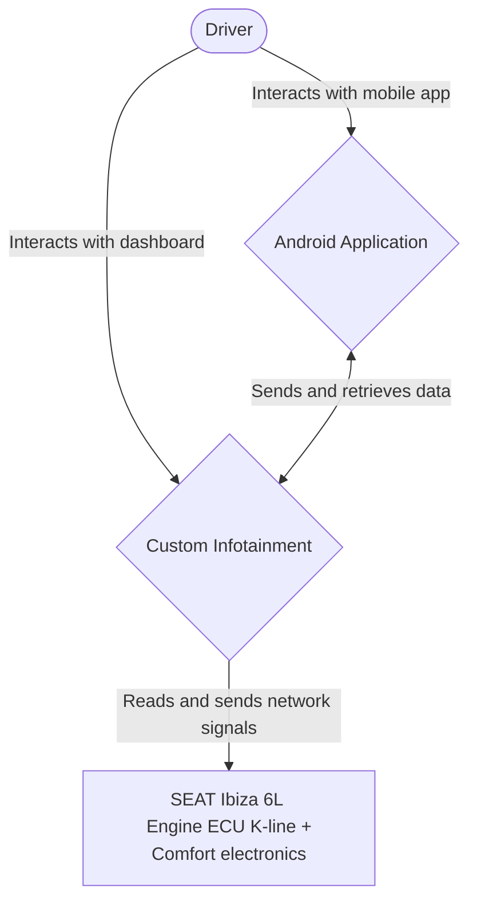

# VAG CAN Infotainment Project

A full-stack automotive project that transforms a **SEAT Ibiza 6L** into a smart car using custom hardware and software. The system reads live engine data from the ECU over the OBD-II K-line, displays it on a custom digital dashboard, integrates Android Auto navigation, and enables **keyless entry** and **remote control** over Bluetooth and GSM.

> Built from scratch — from validating the vehicle's networks to writing firmware, backend, dashboard, and mobile app.

## Project Evolution: From CAN to K-line

The project was first designed around two CAN networks: a Powertrain CAN read by the Raspberry Pi and a Comfort CAN controlled by the ESP32. Testing on the car proved that assumption wrong:

1. A CAN adapter on the OBD-II CAN pins (6/14) received **no frames at all**.
2. The engine ECU was identified as a **Siemens Simos 3PE** (`03E906033D`, 2002), an ECU generation with **no CAN interface** — it only talks over the **K-line** (ISO 9141-2 / KWP2000), a slow request/response diagnostic line.
3. The dashboard was redesigned to **poll** the ECU through an ELM327 adapter instead of **listening** to a CAN bus, and its scope was reduced to RPM, speed and fault codes, since the stock cluster already shows temperature and fuel.

| | Original design (CAN) | Current design (K-line) |
|---|---|---|
| Engine data source | Powertrain CAN, 500 kbps broadcast | Engine ECU over K-line, request/response |
| Pi interface | MCP2515 + TJA1050 (SPI, SocketCAN) | ELM327 Bluetooth adapter (RFCOMM, `python-obd`) |
| Signal discovery | Reverse engineering CAN IDs into a DBC file | Standard OBD-II PIDs (`010C`, `010D`, mode `03`) |
| Dashboard data rate | 10–20 Hz | A few Hz, interpolated in CSS |
| Comfort network (ESP32) | Comfort CAN, 100 kbps | Under verification |

The reasoning behind each step is recorded in [ADR-018 to ADR-020](docs/decisions.md#adr-018-the-vehicle-has-no-powertrain-can--engine-ecu-is-k-line-only). The original design is preserved at the git tag [`v0-can-design`](../../tree/v0-can-design) and in the [architecture docs](docs/architecture.md#original-design-can--superseded).

## What It Does?

| Feature | Description |
|---|---|
| **Live Dashboard** | Real-time RPM and speed displayed on a 7" touchscreen, plus a check engine alert with the stored fault codes |
| **Android Auto** | Google Maps, Waze, Spotify, and calls via HUDIY on the same display |
| **Keyless Entry** | Touch a sensor on the window → ESP32 wakes up → scans for the driver's phone via BLE → locks/unlocks the car |
| **Remote Lock/Unlock** | Send an SMS from the app → SIM800L receives it → ESP32 sends CAN command → doors lock/unlock |
| **Telemetry Reports** | Trip history, fuel consumption averages, and engine temperature logs synced to the mobile app |

## System Architecture

The system is split across two controllers: the Raspberry Pi reads the engine and runs the dashboard, the ESP32 handles keyless entry and remote control:

### Level 1: System Context



| Controller | Network | Role | Stack |
|---|---|---|---|
| **Raspberry Pi 4** (4GB) | Engine ECU over K-line (via ELM327 Bluetooth) | Reads engine data, runs dashboard & Android Auto | Python, python-obd, HUDIY, HTML/CSS/JS |
| **ESP32** | Comfort network (CAN 100 kbps — under verification) | Controls locks, lights, windows. Handles BLE & GSM | C++ |
| **Android App** | — | Remote control & telemetry reports | Dart, Flutter |

> See [Architecture Docs](docs/architecture.md) for full C4 diagrams (Container & Component levels)
>
> See [Sequence Diagrams](docs/sequences.md) for detailed interaction flows

## Hardware

| Component | Role | Interface |
|---|---|---|
| Raspberry Pi 4 (4GB) | Dashboard computer + Android Auto | HDMI (7" touchscreen) |
| ESP32 DevKit | Comfort CAN controller + BLE + GSM bridge | GPIO, UART, SPI |
| ELM327 v1.5 (Bluetooth) | OBD-II adapter for the Pi — handles the K-line to the engine ECU | OBD-II port, Bluetooth RFCOMM |
| SN65HVD230 | CAN transceiver for ESP32 (Comfort) — on hold until the Comfort CAN is confirmed | GPIO, 3.3V |
| SIM800L | GSM/GPRS module for SMS remote control | UART |
| TTP223 | Capacitive touch sensor for keyless entry | GPIO (wake from deep sleep) |
| 7" Touchscreen | Dashboard display | HDMI + USB touch |

## Key Technical Challenges

- **Validating the Design Against the Real Car** — The CAN-based design failed on the vehicle; the cause was traced to a K-line-only ECU (Siemens Simos 3PE) and the architecture was reworked → [Project Evolution](#project-evolution-from-can-to-k-line)
- **Smooth Gauges from a Slow Protocol** — RPM and speed arrive at a few Hz over K-line; polling is decoupled from the UI and the needles interpolate between samples
- **Dual-Controller Architecture** — Two independent controllers (Pi and ESP32) so a dashboard crash never affects locks or remote control
- **Keyless Entry Security** — BLE device authentication with MAC address whitelisting and wake-on-touch via deep sleep GPIO interrupt
- **60fps Dashboard on Pi 4** — GPU-accelerated CSS transitions for smooth gauge animations despite limited hardware

## Project Structure

```
ibiza-smart-car/
├── esp32-firmware/          # C++ — CAN control, BLE, GSM (FreeRTOS)
├── pi-backend/              # Python — CAN reader, telemetry API (SocketCAN)
├── pi-dashboard/            # HTML/CSS/JS — HUDIY widgets, gauges
├── mobile-app/              # Dart — Flutter app (BLE + SMS)
├── dbc/                     # DBC files — decoded CAN signal database
├── docs/
│   ├── architecture.md      # C4 diagrams (Level 2 & 3)
│   ├── sequences.md         # Sequence diagrams (keyless entry, remote lock, etc.)
│   ├── decisions.md         # Architecture Decision Records (ADRs)
│   └── can-bus-reverse-eng.md  # Reverse engineering methodology & findings
└── README.md                # You are here
```

## Tech Stack

| Layer | Technology |
|---|---|
| **Firmware** | C++, ESP-IDF, FreeRTOS, TWAI (CAN) |
| **Backend** | Python 3, python-obd, Bluetooth RFCOMM |
| **Dashboard** | HTML5, CSS3, JavaScript, HUDIY |
| **Mobile App** | Dart, Flutter, flutter_blue_plus |
| **Protocols** | OBD-II over K-line (ISO 9141-2 / KWP2000), CAN 2.0B (Comfort, under verification), BLE 4.2, GSM (AT commands), UART |
| **Tools** | ELM327, VCDS-Lite, SavvyCAN, can-utils, Arduino IDE |

## Documentation

| Document | Description |
|---|---|
| [Architecture](docs/architecture.md) | C4 Container & Component diagrams |
| [Sequence Diagrams](docs/sequences.md) | Interaction flows for all key features |
| [Architecture Decisions](docs/decisions.md) | ADRs explaining why each technology was chosen |
| [CAN Bus Reverse Engineering](docs/can-bus-reverse-eng.md) | Methodology, captured signals, and DBC files (original CAN design) |

## License

This project is for educational and personal use. Not intended for production vehicles.

> ⚠️ **Disclaimer:** Interfacing with a vehicle's CAN Bus can affect safety-critical systems. This project was developed and tested on a simulation bench before any vehicle integration. Use at your own risk.
