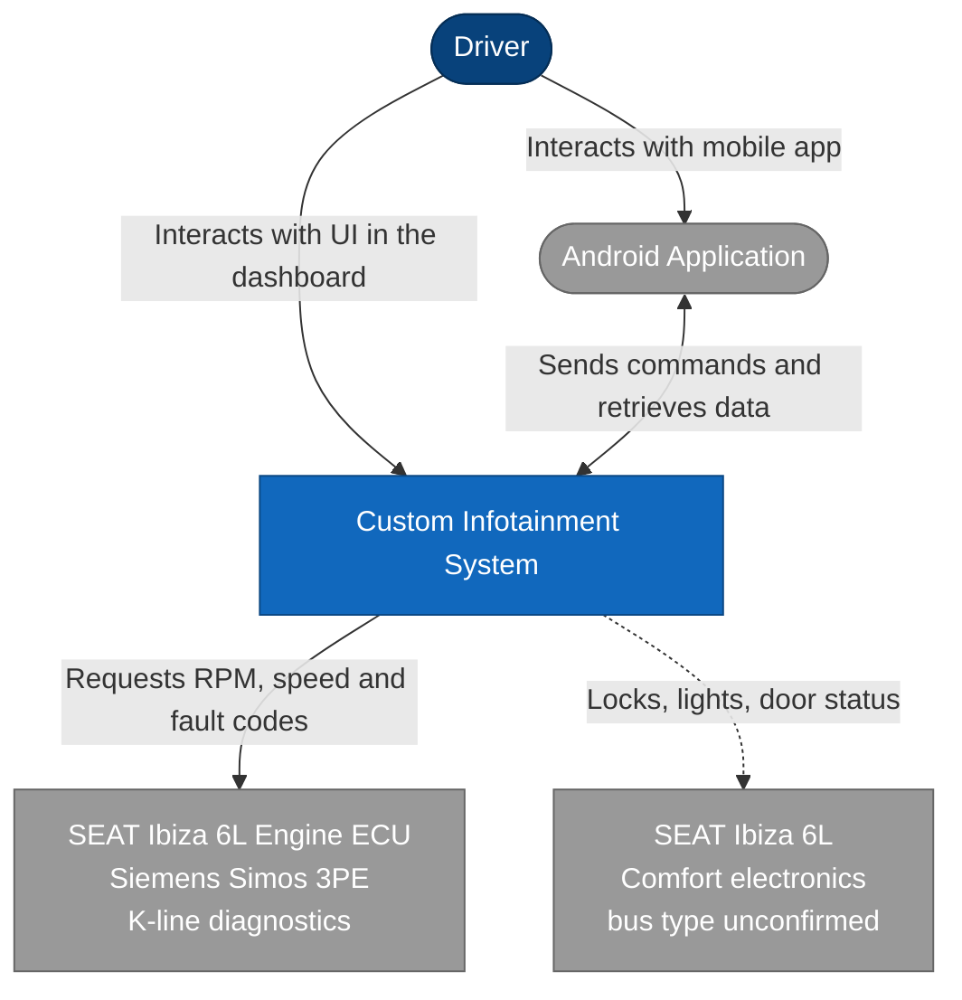
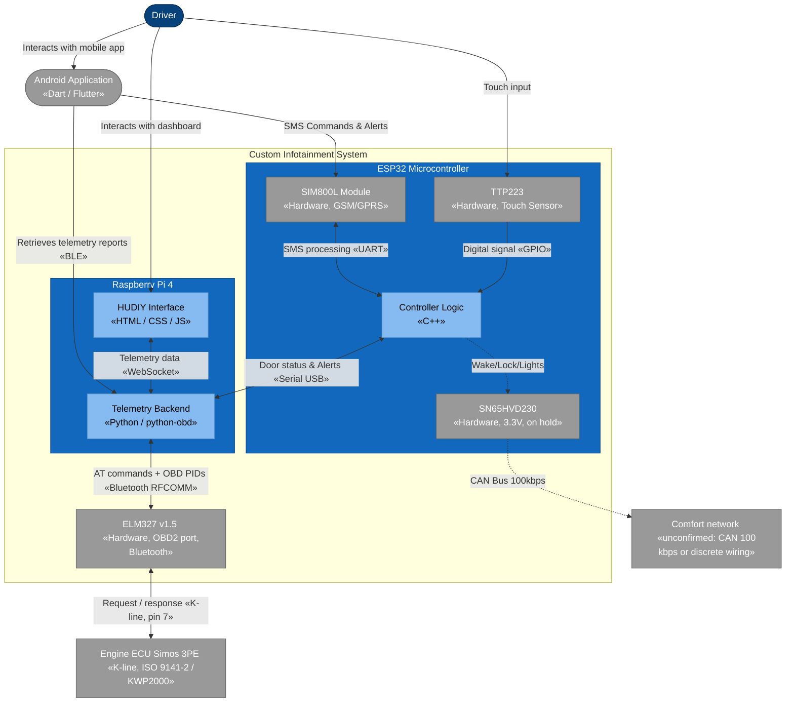
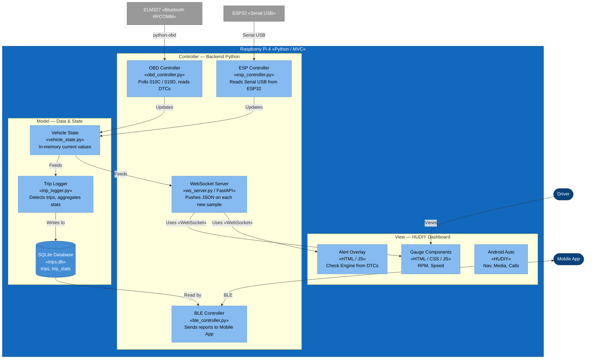
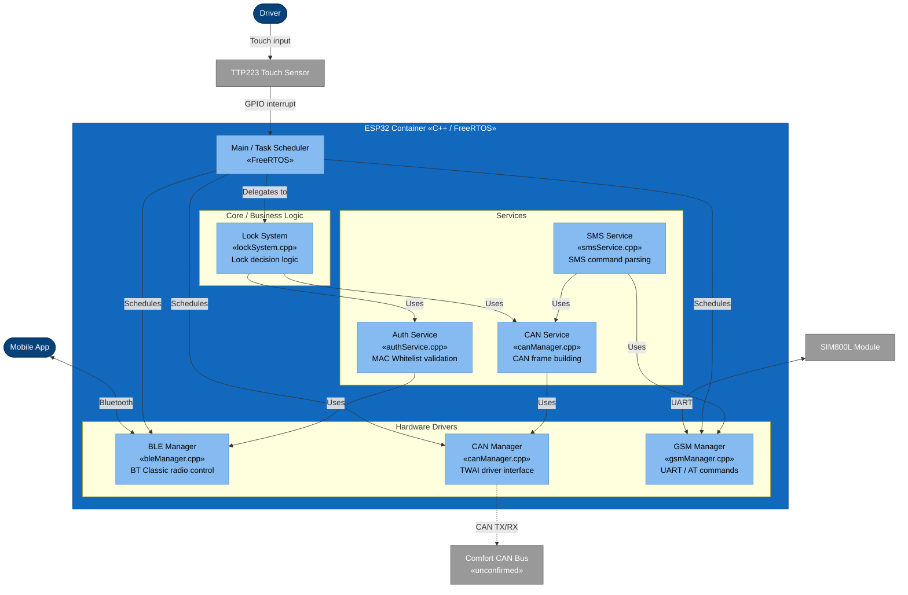
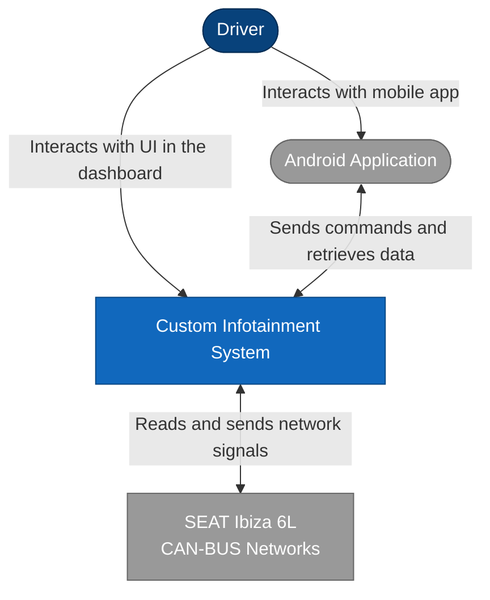
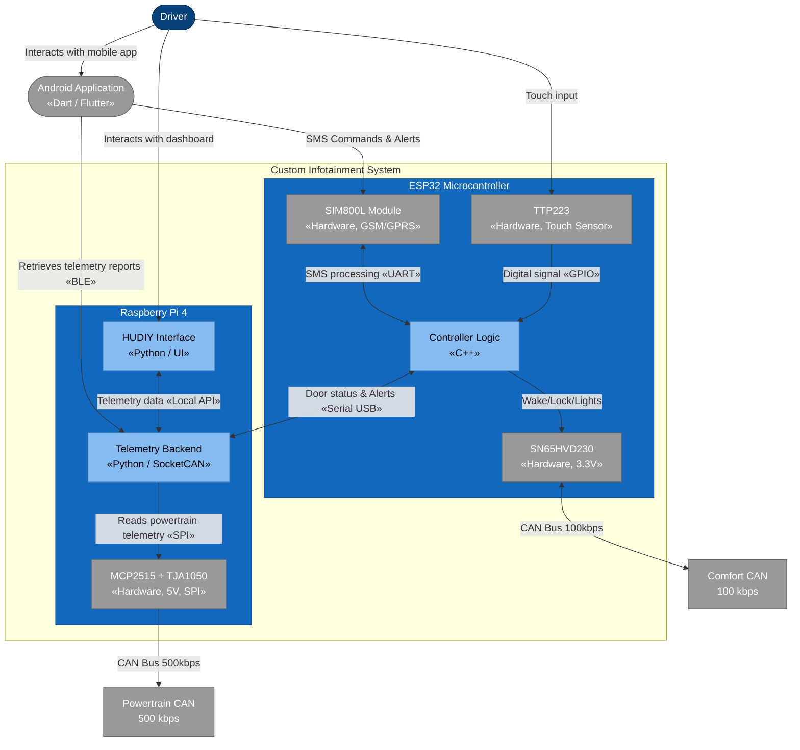
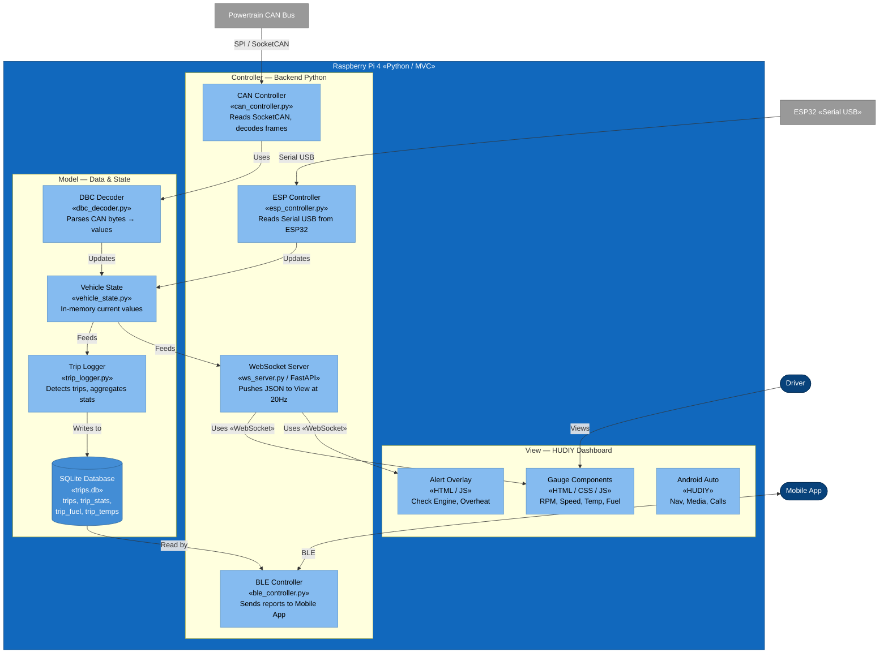

# Architecture (C4 Model)

This document describes the software architecture of the Ibiza Smart Car project using the C4 model. It is broken down into three levels of detail: System Context, Container, and Component.

The document has two parts:

- **[Current design (K-line)](#current-design-k-line)** — what is being built. The engine ECU is read over its K-line diagnostic interface through an ELM327 adapter.
- **[Original design (CAN)](#original-design-can--superseded)** — the first design, which assumed a Powertrain CAN and a Comfort CAN. It was superseded after testing on the car showed that the engine ECU (Siemens Simos 3PE) has no CAN interface. See [ADR-018](decisions.md#adr-018-the-vehicle-has-no-powertrain-can--engine-ecu-is-k-line-only). This design is also preserved at the git tag `v0-can-design`.

Dotted arrows mark links that depend on a pending verification (whether the car has a Comfort CAN).

---

# Current design (K-line)

## Level 1: System Context
Shows how the custom infotainment system interacts with the driver, their mobile phone, and the vehicle.

---

## Level 2: Container Architecture
The Raspberry Pi reads the engine ECU through an ELM327 adapter plugged into the OBD2 port and paired over Bluetooth. The ESP32 keeps its role for keyless entry and remote control; how it reaches the locks depends on whether the car has a Comfort CAN.

---

## Level 3: Component Architecture (Raspberry Pi)
The Python backend keeps the MVC structure of the original design. The change is in the Controller layer: an **OBD Controller** polls the ECU through the ELM327 and replaces the CAN Controller and the DBC Decoder. Because the ECU answers at only a few Hz, polling runs in its own task and the View interpolates between samples ([ADR-020](decisions.md#adr-020-gauge-animation-with-low-rate-polled-data)).

---

## Level 3: Component Architecture (ESP32)
Zooms into the ESP32 Microcontroller container to show how the C++ firmware is structured using a layered architecture to separate hardware drivers from business logic.

> The firmware structure is unchanged from the original design. The **CAN Manager** and **CAN Service** depend on the car having a Comfort CAN, which is still being verified ([ADR-018](decisions.md#adr-018-the-vehicle-has-no-powertrain-can--engine-ecu-is-k-line-only)). If it does not, those two components will be replaced by drivers for the lock actuators, while the business logic (Lock System, Auth Service, SMS Service) stays the same.

---

# Original design (CAN) — superseded

> This was the first design. It assumed the car had a Powertrain CAN (500 kbps) on the OBD2 port and a Comfort CAN (100 kbps) behind the dashboard. Testing on the car showed that the engine ECU has no CAN interface ([ADR-018](decisions.md#adr-018-the-vehicle-has-no-powertrain-can--engine-ecu-is-k-line-only)). The diagrams are kept to document how the design evolved. The ESP32 component diagram was identical to the current one and is not repeated.

## Level 1: System Context (original)

---

## Level 2: Container Architecture (original)
The Raspberry Pi and the ESP32 split the workload between the Powertrain and Comfort CAN buses.

---

## Level 3: Component Architecture — Raspberry Pi (original)
The Python backend followed the MVC pattern: the **Model** held vehicle state and trip data (SQLite), the **Controller** read CAN frames and ESP32 serial data, and the **View** was the HUDIY dashboard rendered in a fullscreen browser.

